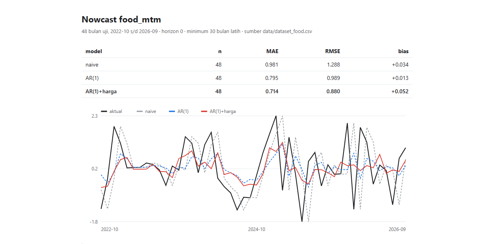

# pangan-nowcast

Harga pangan harian Indonesia (PIHPS, Bank Indonesia) dirapikan jadi SQLite,
sebagai bahan nowcasting inflasi pangan.

Status: tahap 1 (ingest). Belum ada model, belum ada backtest.

## Pasang

```bash
pip install -e ".[dev]"
```

## Pakai

```bash
# daftar komoditas, provinsi, jenis pasar
pangan refs

# satu komoditas, satu tahun
pangan ingest --start 2024-01-01 --end 2024-12-31 --commodity com_13

# semua komoditas, agregat nasional saja (cepat)
pangan ingest --start 2020-01-01 --end 2026-10-23 --province 0

# semua komoditas, semua provinsi (lambat: ~40 detik per komoditas)
pangan ingest --start 2020-01-01 --end 2026-10-23
```

Hasil: `data/pangan.db`, tabel `price(commodity_id, price_type_id, province, date, value)`.
Baris `province = 'Semua Provinsi'` adalah agregat nasional dari sumber.

```sql
SELECT date, value FROM price
WHERE commodity_id = 'com_13' AND province = 'Semua Provinsi'
ORDER BY date;
```

## Dataset untuk model

```bash
pangan cpi                        # unduh inflasi bulanan (FRED) -> tabel macro
pangan dataset --out data/dataset.csv
```

`dataset.csv` satu baris per komoditas per bulan:

| kolom | arti |
|---|---|
| `month` | YYYY-MM |
| `commodity_id` | `com_*` |
| `n_obs` | jumlah hari tercatat di bulan itu |
| `mean`, `last`, `min`, `max`, `std` | statistik harga harian bulan itu |
| `mom_pct` | perubahan `last` vs bulan sebelumnya, persen |
| `cpi_yoy` | inflasi umum nasional year-on-year (persen) |

Kolom tambahan lewat `--extra NAME=SERIES`, misalnya pembanding inflasi umum
bulanan resmi BPS untuk target makanan:

```bash
pangan dataset --target-series food_mtm --target-name food_mtm \
  --extra headline_mtm=bps_headline_mtm --out data/dataset_food.csv
```

## Target BPS (m-to-m kelompok makanan)

FRED hanya menyediakan YoY. Target m-to-m kelompok makanan diambil dari BPS
WebAPI: `var` 1890 (basis 2018=100, 2020-2023) dan `var` 2223 (basis 2022=100,
2024-2026), baris nasional (`vervar` = `INDONESIA`, `turvar` = `Makanan`).

```bash
export BPS_API_KEY=...

pangan bps-pull --var 1890 --th 120:122 --series food_mtm --turvar Makanan
pangan bps-pull --var 1890 --th 123     --series food_mtm --turvar Makanan
pangan bps-pull --var 2223 --th 123:125 --series food_mtm --turvar Makanan
pangan bps-pull --var 2223 --th 126     --series food_mtm --turvar Makanan

# kontrol negatif: kelompok yang tidak terkait harga pangan
pangan bps-pull --var 1890 --th 120:122 --series rokok_mtm --turvar "Rokok dan Tembakau"
pangan bps-pull --var 1890 --th 123     --series rokok_mtm --turvar "Rokok dan Tembakau"
pangan bps-pull --var 2223 --th 123:125 --series rokok_mtm --turvar "Rokok dan Tembakau"
pangan bps-pull --var 2223 --th 126     --series rokok_mtm --turvar "Rokok dan Tembakau"

# pembanding: inflasi umum m-to-m nasional (80+ bulan, lengkap)
pangan bps-pull --var 1 --th 120:122 --series bps_headline_mtm
pangan bps-pull --var 1 --th 123:125 --series bps_headline_mtm
pangan bps-pull --var 1 --th 126     --series bps_headline_mtm
```

- `--th` wajib diisi BPS; maksimal 3 tahun per permintaan. Id periode: 100 = 2000,
  126 = 2026, jadi 120:122 = 2020-2022.
- Hasil: 81 bulan, 2020-01 s/d 2026-09, tanpa bulan hilang.
- Dua basis IHK disambung di 2024. m-to-m adalah persen perubahan bulanan,
  jadi tetap sebanding antar basis; tidak ada penyesuaian level. Ini asumsi yang
  perlu diingat kalau angkanya dipakai untuk klaim jangka panjang.
- Nilai masuk akal: rentang -2,35% s/d +2,30%; YoY implisit 2022 = 5,7%,
  2023 = 6,2%, 2024 = 1,0%, 2025 = 4,9%.

Daftar key gratis di https://webapi.bps.go.id/developer/. Id subjek inflasi = 3.
`bps-pull` mencetak kombinasi `--vervar`/`--turvar` yang tersedia kalau filter
tidak cocok. Adapter sudah diuji terhadap panggilan live.

### Tanpa API key?

WebAPI BPS memang mewajibkan key (gratis). Tapi halaman tabel statistik
menyertakan payload data yang sama di dalam respons Next.js: kirim header
`RSC: 1` ke URL tabel, lalu cari baris yang memuat `"datacontent"`.

Yang sudah diverifikasi pada tabel di atas:

- `var` 2223 = Inflasi Bulanan (M-to-M) (2022=100) Makanan, Minuman dan Tembakau
- `turvar` 1551 = Makanan, Minuman dan Tembakau; 1552 = Makanan;
  1553 = Minuman tidak beralkohol; 1554 = Minuman beralkohol; 1666 = Rokok
- `vervar` 1..150 = kabupaten/kota, **151 = INDONESIA**
- 5.652 titik data, `turtahun` Januari-Desember + Tahunan

Batasan: halaman hanya menyajikan tahun yang sedang dipilih (saat ini 2026).
Tombol ganti tahun memakai aksi internal Next.js yang tidak bisa direplikasi
lewat GET biasa (10 variasi parameter sudah dicoba). Jadi riwayat 2020-2025
praktis butuh API key.

## Sumber data

Endpoint `bi.go.id/hargapangan/WebSite/TabelHarga/GetGridDataKomoditas`.
Tidak resmi, tidak didokumentasikan, bisa berubah tanpa pemberitahuan.

- `com_*` = komoditas, `cat_*` = kategori. Ingest default hanya `com_*`.
- `price_type_id`: 1 pasar tradisional, 2 modern, 3 pedagang besar, 4 produsen.
- `province_id=0` mengembalikan baris agregat `Semua Provinsi`; kosong = semua provinsi.
- Tanggal tanpa pencatatan (akhir pekan, libur) tidak muncul sebagai kolom.
- Nilai `-` disimpan sebagai `NULL`.
- Rentang panjang dipecah per tahun; tiap permintaan ~5 detik.

Inflasi bulanan diambil dari FRED `CPALTT01IDM659N` (OECD MEI), tanpa API key.
Batasan: itu inflasi umum **year-on-year**, bukan m-to-m dan bukan kelompok makanan,
dan mengikuti jadwal OECD sehingga sekitar 1-1,5 tahun terakhir bisa tertinggal.
Nilai 2024-01 = 2,57 cocok dengan inflasi YoY resmi BPS.
Untuk m-to-m per kelompok, pakai BPS WebAPI (butuh API key gratis).

Hormati sumbernya: `--sleep 1` default, jangan jalankan paralel.

## Laporan HTML

```bash
pangan report --dataset data/dataset_food.csv --target food_mtm --out report.html
```

Satu file mandiri: tabel metrik, grafik aktual vs prediksi (SVG inline), dan
ringkasan CI. Tanpa JavaScript atau dependensi tambahan.



## Ekspor dataset + datasheet

```bash
pangan export --dataset data/dataset_food.csv --out data/publish
```

Menghasilkan dua berkas: `pangan_nowcast_monthly.csv` (1722 baris, 82 bulan,
21 komoditas) dan `pangan_nowcast_monthly_datasheet.md`. Semua angka di datasheet
dihitung dari data, termasuk jumlah baris tanpa target/pembanding. `data/` tetap
gitignored; yang di-commit hanya kode ekspornya.

Publikasi ke Hugging Face Datasets butuh login lebih dulu (`hf auth login`) dan
nama repo tujuan; belum dijalankan karena belum ada kredensial di mesin ini.

## Hasil backtest

Rolling-origin, `--min-train 30`, tiap prediksi hanya memakai data sebelum bulan uji.
`horizon=0` = nowcast: fitur harga bulan t, target bulan t (CPI rilis awal t+1).
`horizon=1` = forecast: fitur bulan t, target bulan t+1.

| target | horizon | model | n | MAE | RMSE |
|---|---|---|---|---|---|
| `cpi_yoy` (inflasi umum YoY) | 0 | naive | 31 | 0.361 | 0.465 |
| `cpi_yoy` | 0 | AR(1) | 31 | 0.398 | 0.506 |
| `cpi_yoy` | 0 | AR(1)+harga | 31 | 0.398 | 0.511 |
| `food_mtm` (makanan m-to-m) | 0 | naive | 48 | 0.981 | 1.288 |
| `food_mtm` | 0 | AR(1) | 48 | 0.795 | 0.989 |
| `food_mtm` | 0 | AR(1)+harga | 48 | 0.714 | **0.880** |
| `food_mtm` | 0 | AR(1)+headline | 48 | **0.594** | 0.910 |
| `food_mtm` | 1 | naive | 47 | 0.987 | 1.297 |
| `food_mtm` | 1 | AR(1) | 47 | 0.784 | 0.981 |
| `food_mtm` | 1 | AR(1)+harga | 47 | 0.771 | 0.938 |
| `food_mtm` | 1 | AR(1)+headline | 47 | 0.800 | 1.046 |
| `rokok_mtm` (kontrol negatif) | 0 | naive | 48 | 0.189 | 0.284 |
| `rokok_mtm` | 0 | AR(1) | 48 | 0.185 | 0.278 |
| `rokok_mtm` | 0 | AR(1)+harga | 48 | 0.183 | 0.279 |
| `minuman_mtm` (kontrol) | 0 | naive | 48 | 0.130 | 0.177 |
| `minuman_mtm` | 0 | AR(1) | 48 | 0.108 | 0.181 |
| `minuman_mtm` | 0 | AR(1)+harga | 48 | 0.110 | 0.183 |
| `alkohol_mtm` (kontrol) | 0 | naive | 48 | 0.231 | 0.290 |
| `alkohol_mtm` | 0 | AR(1) | 48 | 0.165 | 0.213 |
| `alkohol_mtm` | 0 | AR(1)+harga | 48 | 0.165 | 0.213 |

Selisih MAE fitur harga, bootstrap 5.000 resample:

- `food_mtm` horizon 0 vs AR(1): **-0.082** [-0.147, -0.017]
- `food_mtm` horizon 1 vs AR(1): -0.013 [-0.064, +0.038]
- `food_mtm` horizon 0 vs naive: **-0.268** [-0.436, -0.107]
- `food_mtm` horizon 0 vs AR(1)+headline: +0.119 [-0.074, +0.292]
- `food_mtm` horizon 1 vs AR(1)+headline: -0.029 [-0.135, +0.053]
- `cpi_yoy` horizon 0 vs AR(1): -0.001 [-0.019, +0.017]
- `rokok_mtm` kontrol vs AR(1): -0.002 [-0.009, +0.005]
- `minuman_mtm` kontrol vs AR(1): +0.002 [+0.000, +0.004]
- `alkohol_mtm` kontrol vs AR(1): +0.001 [-0.010, +0.011]

Kesimpulan: harga pangan harian menambah akurasi dibanding naive dan AR(1)
untuk **nowcast** inflasi makanan m-to-m. Namun dibandingkan model yang sudah
memakai inflasi umum bulanan resmi BPS (`AR(1)+headline`), tambahannya **tidak
signifikan**: selisih MAE +0.119 (95% CI -0.074 s/d +0.292) untuk nowcast, dan
-0.029 (95% CI -0.135 s/d +0.053) untuk forecast satu bulan. Titik estimasi MAE
AR(1)+headline justru lebih rendah pada nowcast (0.594 vs 0.714).

Untuk forecast satu bulan ke depan, tambahan fitur harga tidak signifikan baik
dibanding AR(1) maupun headline. Untuk inflasi umum YoY, tidak ada tambahan sama
sekali. Sinyal harga pangan bersifat kontemporer, bukan prediktif, dan sebagian
besar informasinya sudah tercermin di inflasi umum bulanan.

Kontrol negatif: tiga kelompok yang tidak dipengaruhi harga beras/cabai/daging —
`rokok_mtm`, `minuman_mtm`, `alkohol_mtm` — tidak membaik; selisihnya -0.002,
+0.002, dan +0.001 (semua praktis nol). Artinya perbaikan di `food_mtm` bukan
artefak pipeline atau overfitting fitur, tapi spesifik ke kelompok yang harganya
memang kita pantau.

Catatan daya uji: varians ketiga kontrol jauh lebih kecil (MAE AR 0,108-0,185 vs
0,795 untuk makanan), jadi ruang perbaikan di sana memang sempit. Hasil nol ini
konsisten dengan kontrol yang valid, tapi bukan bukti sekuat uji pada target
bervarians besar.

Batasan: 48 bulan uji, target disambung antar dua basis IHK, fitur masih rata-rata
sederhana tanpa bobot konsumsi, dan satu kali spesifikasi (tanpa tuning). Fitur
memakai harga sepanjang bulan, jadi ini nowcast akhir bulan (CPI belum rilis),
bukan prediksi sebelum bulan berjalan.

Catatan pembanding `headline_mtm`: nilainya dirilis BPS bersamaan dengan target
`food_mtm` (awal bulan berikutnya), jadi model `AR(1)+headline` **bukan** nowcast
yang bisa dipakai sebelum rilis. Perannya menguji informasi tambahan: apakah
PIHPS masih menjelaskan inflasi makanan setelah inflasi umum diketahui. Jawabannya
belum terbukti. Korelasi `food_mtm` vs `headline_mtm` = 0.580 (81 bulan).

## Selanjutnya

1. Indeks harga berbobot konsumsi. Terblokir: bobot per komoditas tidak tersedia
   sebagai variabel WebAPI (sudah dicek), jadi perlu Diagram Timbang dari publikasi
   BPS (PDF/Excel) dan pemetaan komoditas PIHPS ke komoditas IHK.
2. Publikasikan dataset fitur bulanan (Hugging Face Datasets) + datasheet.
3. Pembanding resmi BPS: headline sudah selesai dan hasilnya nol (lihat di atas).
   Langkah berikutnya IHK makanan level (var 2212, 2022=100) — lewat WebAPI hanya
   tersedia 2024+, jadi riwayat 2020-2023 butuh arsip publikasi BPS.

## Test

```bash
pytest
```
